# Currawong

A pocket music player with a haptic dial. Streams Spotify, plays local FLAC, and outputs to wired headphones through a USB DAC or to Bluetooth headphones. A Raspberry Pi Zero W runs the audio and UI on a 1-bit Sharp memory LCD, and an ESP32-S3 drives a brushless motor as a software-defined dial.

<p align="center">
  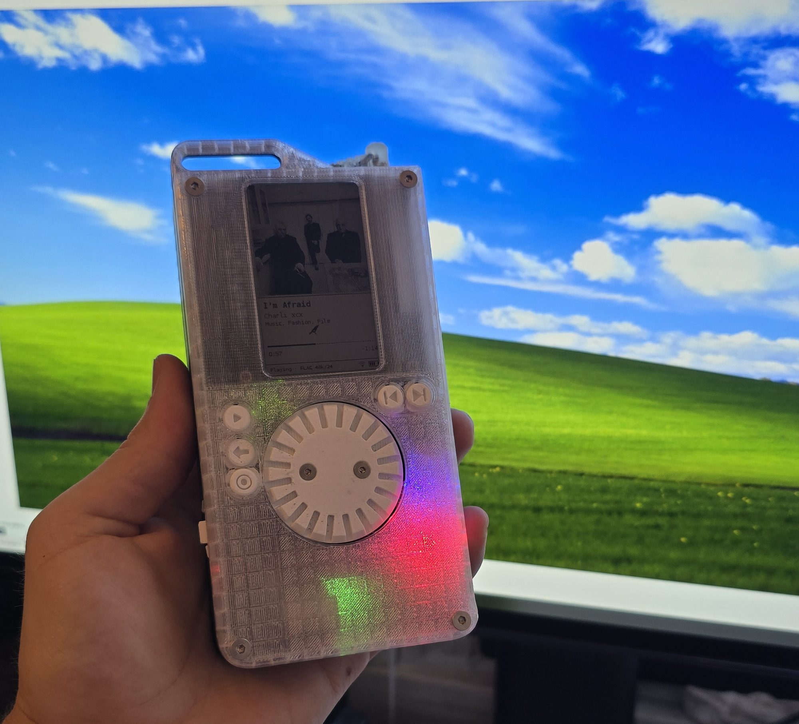
</p>

<p align="center">
  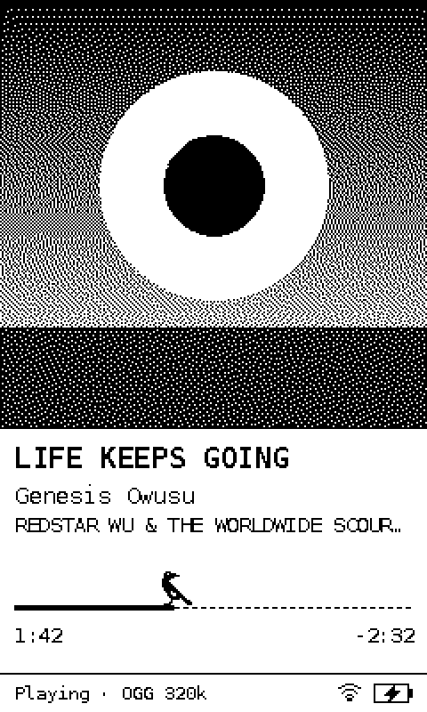
  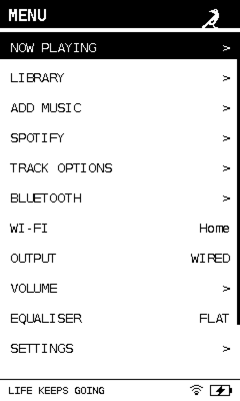
  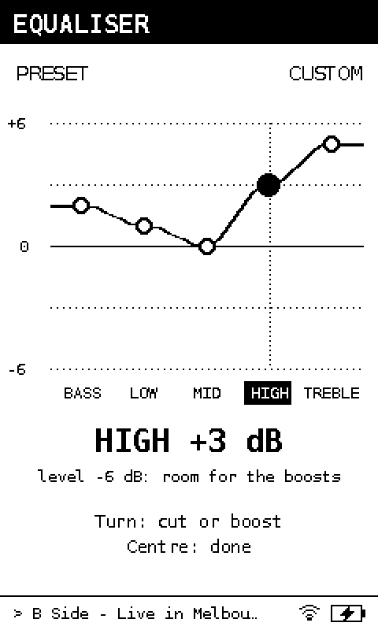
</p>

## Why

Currawong started, and remains, a gift. I started about three weeks before it was due, so time pressure was high, especially fitting it around work. I listen to a lot of music, and it brings me a lot of joy. One thing that feels increasingly problematic is the lack of intentionality in what we listen to and how we support artists. On top of this, I'm an increasing fan of the idea that something doesn't have to do everything, and that the friction between things leads to more intentionality. Hence the desire to build a dedicated music player, and a high-quality one at that.

That being said, as Currawong is a gift, I did want versatility in this approach. The end goal is a device that can be used day to day with limited compromises, and one that is built with care and attention. Hopefully this means it can bring a little bit of joy every day. Because of that, Currawong supports both Spotify and offline FLAC/MP3 playback, with the weighting on offline functionality. It also supports wired and Bluetooth audio devices, again with more weight on the wired approach.

## Features

**Playback**
- Spotify Connect receiver via [go-librespot](https://github.com/devgianlu/go-librespot), shown as "Currawong" in the Spotify app
- Local library (FLAC and other formats) via [MPD](https://www.musicpd.org/), with artists, albums, playlists and an Up Next queue
- Wired output through a [Moondrop Dawn Pro 2](https://www.linsoul.com/products/moondrop-dawn-pro2) USB DAC with hardware volume, or Bluetooth A2DP via [BlueALSA](https://github.com/arkq/bluez-alsa)
- Five-band equaliser on the wired output (alsaequal with [CAPS](https://wiki.linuxaudio.org/apps/all/caps) Eq10, ±6 dB per band)
- Pinned Spotify playlists, shuffle, repeat, add to playlist
- Browser upload page at `http://currawong.local` for adding music from any device on the same network

**Interface**
- 240 × 400 portrait UI on a 1-bit Sharp memory LCD, rendered event-driven: a screen is only redrawn when something on it changes, and only the changed panel lines are sent
- A simple cover, track and progress screen for Spotify. Local files add spectrum strips down the sides, and an oscilloscope page in FULL visuals (Settings > Visuals: FULL, REGULAR or FAST)
- An animated pixel currawong that sings, hops, sleeps and idles depending on playback state, plus a boot animation
- On-screen keyboard for joining Wi-Fi, Bluetooth pairing, sleep and auto-off timers, and settings for dial feel, button click strength and screen rotation

**Haptic dial**
- Voltage-mode FOC on a [DFRobot 2804](https://www.dfrobot.com/product-3005.html) gimbal motor with an AS5600 magnetic encoder, using [SimpleFOC](https://simplefoc.com)
- The UI sets the dial's feel per screen: one detent per item with end stops in menus, 48 light clicks per turn for scrubbing with walls at 0:00 and the end of the track, one click per dB on the equaliser
- Momentum coasting on long lists, stronger landmark clicks at each new letter, a magnetic pull to the playing track in Up Next
- The dial spins a full turn on track skip and rolls while auto-scrubbing, and can be pocket-locked
- Firmware updates are sent from the Pi over the existing UART link and written to the ESP32's spare OTA partition, so the dial never needs to come out of the case to be reflashed
- Haptic approach follows the open-source [SmartKnob](https://github.com/scottbez1/smartknob)

**Power**
- 5000 mAh single-cell LiPo through an Adafruit PowerBoost 1000C, with a MAX17048 fuel gauge
- Low-battery alerts on the dial at 10% and 5%, and a clean shutdown at low charge or low cell voltage
- Motor is disabled after 3 s without movement, and the ESP32 drops to 80 MHz while idle

## System

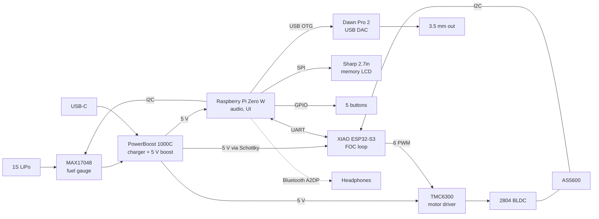

| Part | Role |
| --- | --- |
| [Raspberry Pi Zero W](https://www.raspberrypi.com/products/raspberry-pi-zero-w/) | Audio (go-librespot, MPD), UI, display, buttons |
| [Seeed XIAO ESP32-S3](https://www.seeedstudio.com/XIAO-ESP32S3-p-5627.html) | Haptic dial: FOC loop, encoder, UART link to the Pi |
| [SparkFun TMC6300 breakout](https://www.sparkfun.com/sparkfun-brushless-motor-driver-3-phase-tmc6300.html) | 3-phase motor driver |
| [DFRobot 2804 motor with AS5600](https://www.dfrobot.com/product-3005.html) | Dial motor and angle sensor |
| [Adafruit Sharp 2.7" memory LCD](https://www.adafruit.com/product/4694) | 400 × 240, 1-bit, mounted portrait |
| [Moondrop Dawn Pro 2](https://www.linsoul.com/products/moondrop-dawn-pro2) | USB DAC and headphone amp |
| [Adafruit MAX17048](https://www.adafruit.com/product/5580) | Battery fuel gauge |
| [Adafruit PowerBoost 1000C](https://www.adafruit.com/product/2465) | Charger and 5 V boost |
| Custom PCB (Currawong v1.0) | Carrier for all of the above, designed in [KiCad](https://www.kicad.org/) |

<p align="center">
  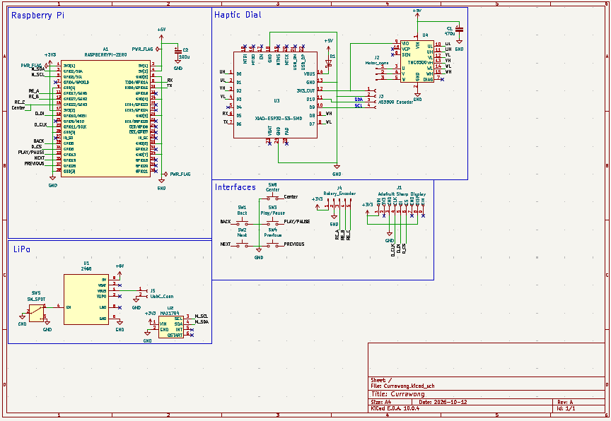
  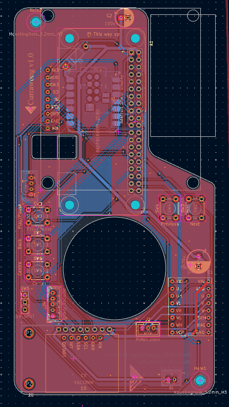
</p>

Pin maps, the power budget, display protocol and firmware limits are in [docs/hardware.md](docs/hardware.md). The Pi to dial protocol is in [docs/dial-protocol.md](docs/dial-protocol.md).

## Repository layout

```
pi/                      Raspberry Pi software: UI, setup script, upload page, character assets
firmware/currawong_knob/ ESP32-S3 haptic dial firmware (PlatformIO, Arduino, SimpleFOC)
animation/               Boot animation frames and a desktop preview player
hardware/pcb/            KiCad project, custom symbols and footprints, Gerbers, 3D STEP
hardware/case/           SolidWorks sources and print-ready STL
hardware/logos/          DXF artwork for the case
docs/                    Hardware reference, dial protocol, setup guide, photos and UI renders
```

## Building one

1. **PCB:** order from the Gerbers in [hardware/pcb/fabrication](hardware/pcb/fabrication).
2. **Case:** print the STLs in [hardware/case/stl](hardware/case/stl). You'll also need:
   - 6 × M3 threaded inserts
   - 6 × M3 × 12 mm countersunk screws
   - 2 × M3 nuts
   - 2 × M3 × 8 mm socket head screws
   - 6 × M2.5 × 8 mm countersunk screws
3. **Dial firmware:** flash once over USB with PlatformIO. See [firmware/currawong_knob](firmware/currawong_knob).
4. **Pi:** flash Raspberry Pi OS Lite (32-bit), copy [pi/](pi) across and run `sudo bash currawong_setup.sh`. See [docs/setup.md](docs/setup.md).

The UI also runs on a desktop with no hardware attached. `python3 pi/currawong_ui.py --preview` renders each screen to PNG, and `python3 pi/bird_preview.py` renders the currawong's animations. Every UI image in this README was made that way.

## Design notes

Many design decisions here were compromises for the sake of delivering on time, and many were additions to bring it closer to the end goal of a little more joy.

### The dial

I saw a video a while ago on the open-source [SmartKnob](https://github.com/scottbez1/smartknob) project and thought it was an incredibly cool and satisfying input method. Later I saw it again in two of Teenage Engineering's products, in particular the [TP-7](https://teenage.engineering/products/tp-7). For me this felt like the perfect input method for Currawong. It pulls inspiration from the iconic [iPod click wheel](https://en.wikipedia.org/wiki/IPod_click_wheel), which carries an incredible amount of nostalgia and to me always felt a little like magic. The haptic dial takes it one step further by being physically responsive: something that feels unapologetically tactile. This is why it was a clear winner over a rotary encoder. While waiting for the haptic dial parts I used a rotary encoder as a placeholder, but it just wasn't right. It only truly felt like magic once the haptic dial was set up.

The feel changes with the screen. A menu gets one detent per item with walls at each end, scrubbing gets 48 light clicks per turn with walls at 0:00 and the end of the song, and the equaliser clicks once per dB. Flick through a long list and the clicks fade so it coasts, then come back as it slows. Each new letter in Artists and Albums clicks harder, and in Up Next the playing track pulls the dial in like a magnet.

<p align="center">
  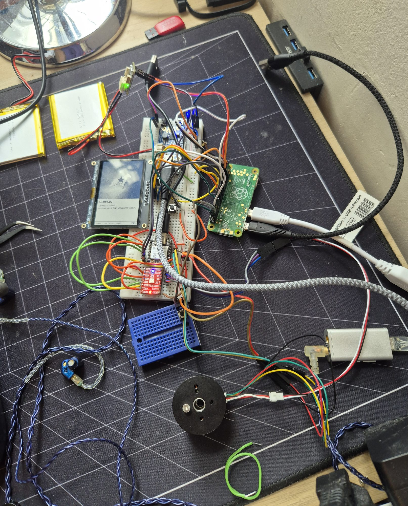
  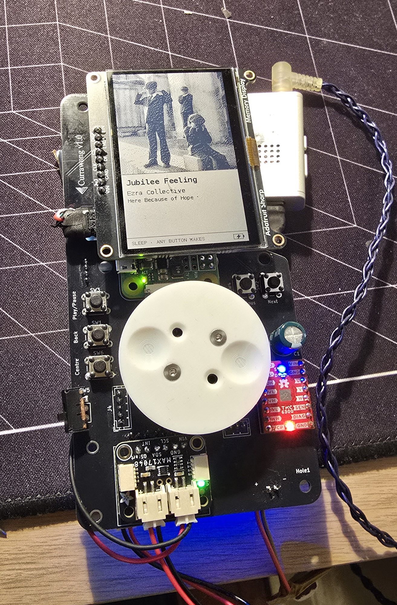
</p>

### Splitting the processors

The processors were split after testing the Pi with a rotary encoder. With a single core, the Pi already struggles with responsiveness across the device. So to avoid any further impact, the ESP32 takes on polling the magnetic encoder and driving the motor itself. In the end this worked exceptionally well.

The two talk over a 115200 baud UART using checksummed, NMEA-style lines. The Pi only sends high-level commands (`CFG,list,12,3` is a 12-item menu, sitting on item 3) and gets positions back, so the FOC loop never waits on Linux. The Pi also can't reach the ESP32's boot pins, so firmware updates go over the same link: the image is sent in acknowledged chunks to the spare OTA partition, and the ESP32 only switches over once the MD5 matches. Once the dial is in the case, it never needs to come out to be reflashed.

### Living with a Pi Zero W

Unfortunately, the original intention of using a [Pi Zero 2 W](https://www.raspberrypi.com/products/raspberry-pi-zero-2-w/) had to be abandoned due to a complete shortage. Everywhere I looked there were none, or a long, long wait. I even tried alternatives like the [Orange Pi](https://en.wikipedia.org/wiki/Orange_Pi), but the prices here were astronomical. In the end I was stuck with a Raspberry Pi Zero W, which meant some things had to be cut in the name of performance. The original idea had spectrum visualisers lining the sides of Now Playing and a separate one for a full-screen mode. The goal was to push the Sharp display to its limit. Sadly this had to be mostly shelved. It still exists in the code under a UI setting but hasn't been updated since the first couple of prototypes. Maybe next time.

<p align="center">
  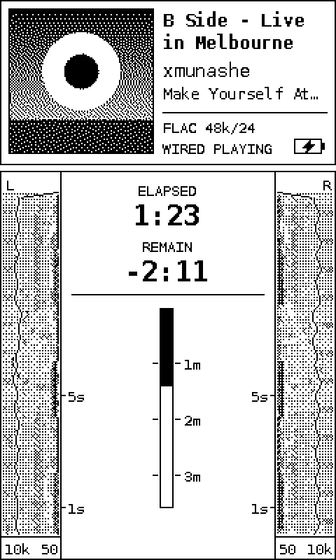
  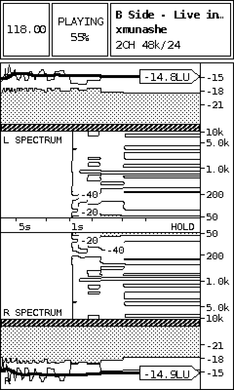
</p>

To keep everything else smooth on one core, go-librespot (about 35% CPU streaming at 320 kbps) runs at a higher priority than the UI, and only one player holds the DAC at a time. The UI only redraws when something on screen changes, and only sends the changed lines to the display, which takes about 50 ms for a full frame.

### The currawong

One of the key additions in achieving the goal of a little more joy was the animations. Made by hand in Pixel, they were incredibly fun to make and I think paid dividends. I'm by no means a talented visual artist, but I am proud of this little singing, dancing and sleeping currawong.

Under the hood it's a sheet of 32 × 32 sprites driven by a JSON spec of sequences, ticking at 8 fps off the clock so a late frame never makes it drift. Each frame only touches the columns the bird is in, so the panel gets a small partial update rather than a full redraw.

<p align="center">
  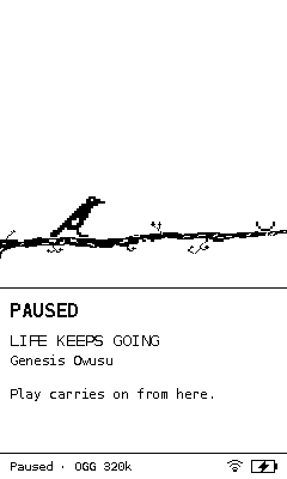
  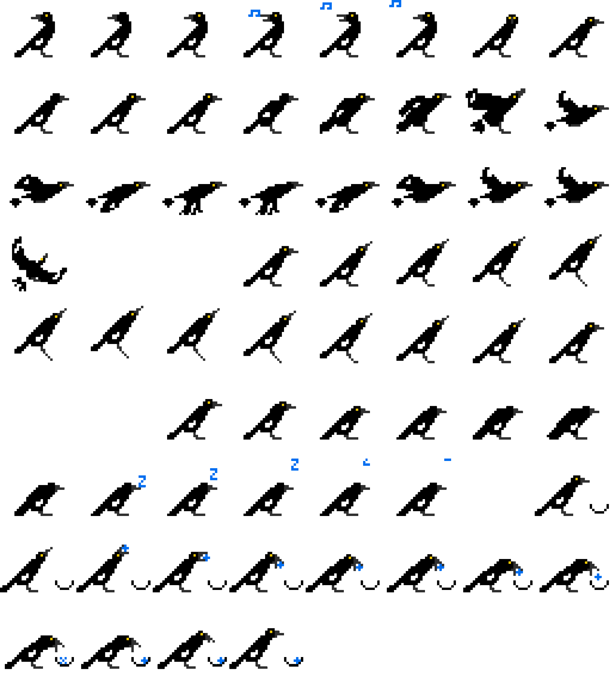
</p>

## What went wrong

One of the first "disaster" moments was when the first Pi was fried (well, probably just the Wi-Fi) by a stupid mistake of mine: swapping 5 V and 3.3 V. This resulted in me ordering another, before eventually figuring out it was just the SD card that had corrupted. So I was left with two working Pis, which is better than one. I would eventually need it when I did actually fry one. In a particularly painful mistake, after soldering all the components onto the PCB, I was testing a custom micro-USB to USB-C cable I'd made for the DAC when it all went wrong. The Pi started heating up like crazy and I quickly unplugged it. Following a very long desoldering process, with more destruction than I'd care to admit, I eventually got back up and running with the original Pi.

Another last-minute change was battery size. Originally I had a 2200 mAh LiPo and assumed I'd get good battery life. But after some testing it was clear it wasn't going to be enough. I debated between a 5000 mAh LiPo and a 21700 Li-ion cell, and eventually decided on the LiPo to keep it similar. This came with its own challenges, mainly packaging, and as a result Currawong grew. This led me down the path of "how do I make something big feel small?". This is easier said than done, but after some aggressive cut-ins, then a step back and some less aggressive cut-ins, then expanding the transparent front, I think that while it's still big, it's a lot more comfortable.

<p align="center">
  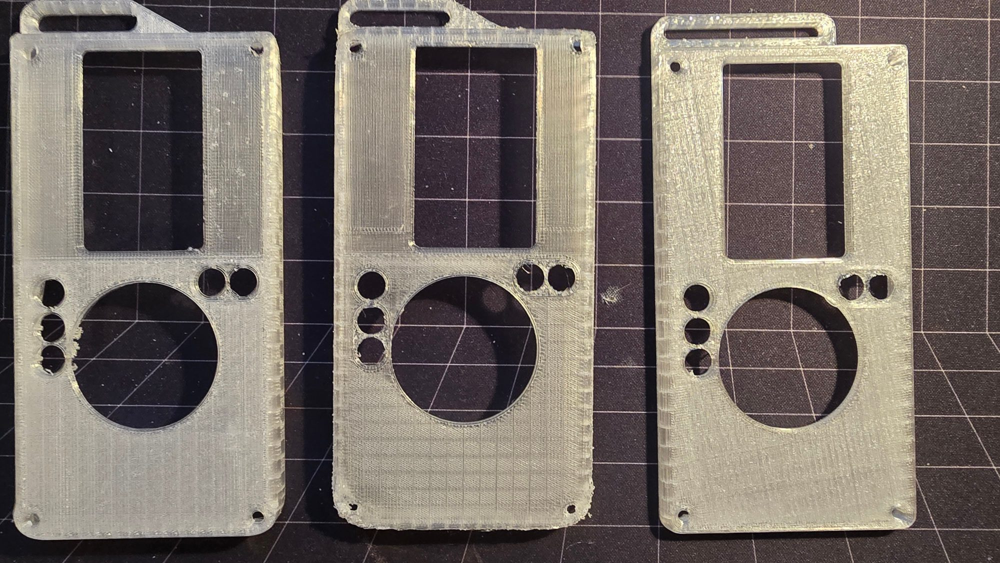
  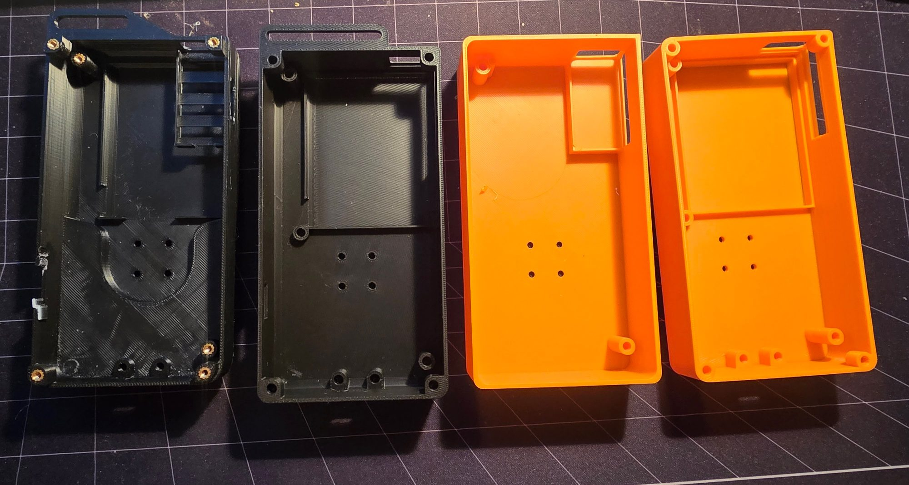
</p>

## What I'd change in v2

So many changes for a v2, with the luxury of lessons learnt and more time. There would have to be a decision here: stick with Spotify support or drop it. Dropping it would let me move away from the large, clunky and very slow-booting Pi Zero to something like another MCU. This would massively reduce size, decrease boot time, reduce power usage and potentially increase display responsiveness. But say I wanted to keep it, what else would I change? Well, I would switch to the Pi Zero 2 W. It's quad-core, much more modern and gives me so much more headroom. This way the visualiser ideas can come back.

As for the board, this would also change a lot. Instead of breakouts galore, these functions should be brought onto the PCB. It would allow for a cheaper result, more freedom in the design and a MUCH smaller package. One of my pet peeves is also charging speed. The PowerBoost charges at up to about 1 A, so the 5000 mAh cell takes five hours or more. Having more control over the components would allow faster charging, which is much needed. Bringing the motor driver on board would also mean its current-sense and fault pins could finally be wired up.

Again on size, the motor stack. Being by far the tallest part, integrating the magnetic encoder into the PCB and choosing a thinner motor would help a lot with the case packaging.

I'd also explore different case manufacturing methods. I'm a strong believer that most FDM printing should be kept to prototypes, and because of that this feels a bit like a prototype. A clear resin case would look great here, and if Spotify was dropped, a CNC'd aluminium back case would also look gorgeous.

<p align="center">
  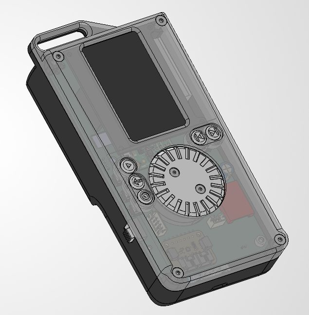
  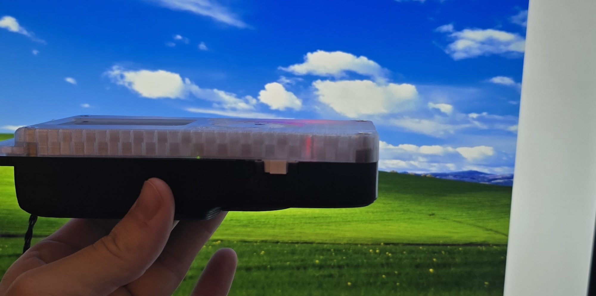
</p>

## Licence

Software (everything in `pi/`, `firmware/` and `animation/`) is under the [MIT Licence](LICENSE).
Hardware designs (everything in `hardware/`) are under the [CERN Open Hardware Licence v2, Permissive](LICENSE-HARDWARE).

Built by [Jasper Japp](https://jasperjapp.com).
